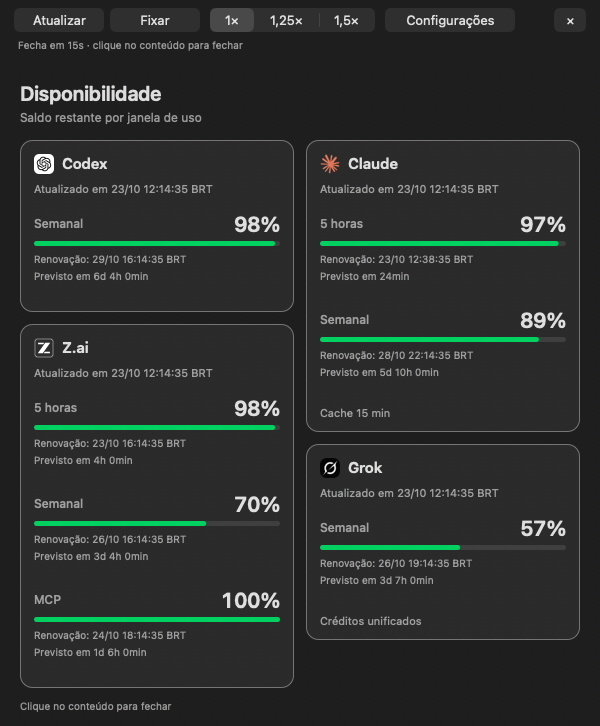
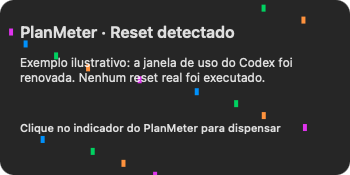
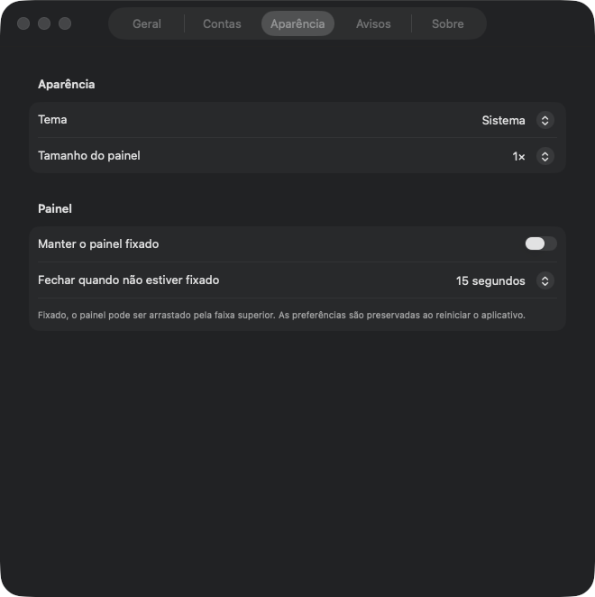

# PlanMeter

Quotas de Codex, Claude Code, Z.ai, Kimi Code e Grok na barra de menus do macOS.

O PlanMeter é um aplicativo Swift/AppKit que mostra o saldo disponível, as janelas de uso e as previsões de reset fornecidas por cada serviço. Inclui histórico local e confete para celebrar resets. Não inicia conversas com modelos para medir quotas.


## Painel de quotas

Clique no indicador para abrir o painel completo. Só aparecem provedores com percentuais válidos, tanto na barra quanto no painel. Saldo de **0%** continua visível. Se nenhuma métrica estiver disponível, a barra mostra apenas **PlanMeter**, mantendo o acesso à configuração.



- **Atualizar** solicita novas leituras, respeitando os intervalos de cada provedor.
- **Fixar** mantém a janela aberta e permite movê-la pela faixa superior. **Desafixar** reativa o prazo configurado para fechamento, de 15 segundos por padrão.
- **1×, 1,25× e 1,5×** ajustam o tamanho.
- **Configurações** abre uma janela independente com contas, aparência, início automático, avisos e informações do aplicativo.
- **×** fecha o painel e desativa a fixação. Sem fixar, um clique no conteúdo também o fecha; os controles continuam utilizáveis.

Uma falha temporária de consulta pode preservar a última métrica conhecida, marcada como desatualizada. O Kimi só aparece após uma consulta autenticada nesta execução e fica oculto se o acesso à chave falhar. O cache não comprova autenticação.

## Histórico e avisos de renovação

O histórico registra as janelas conhecidas de Codex, Claude, Z.ai, Kimi Code e Grok. Quando o provedor fornece o início do período, a data aparece como informada. Quando fornece apenas a duração e a próxima renovação, o início é inferido por subtração. Janelas sem início nem duração conhecidos não recebem uma data inventada.

Cada registro identifica a origem da data e se uma mudança também foi detectada entre leituras. Uma data inferida representa o início calculado da janela, não a confirmação do instante exato em que o saldo foi reposto. Dados antigos continuam identificados pelo horário em que foram observados.

O menu mostra até **cinco registros por provedor**. Clique em **Histórico…** para abrir a lista completa e use **Exportar CSV…** para escolher onde salvar uma cópia. Clique no cabeçalho de qualquer coluna para ordenar e clique novamente para inverter a direção; o CSV segue a ordem da tabela. `⌘W` fecha apenas a janela ativa e `⌘Q` encerra o aplicativo. Releituras do mesmo período não criam novas linhas; uma detecção posterior melhora o registro existente.

Os avisos com confete continuam ligados às renovações confirmadas por comparação de leituras do Codex ou do Claude com identidade verificável. O preenchimento inicial do histórico com janelas inferidas não dispara avisos retroativos.



As imagens usam dados fictícios. O aviso foi capturado na interface real com um evento simulado; nenhum reset ou consumo de modelo foi executado para produzi-lo.

## Como funciona

| Provedor | Fonte | Preparação |
| --- | --- | --- |
| Codex | `account/read` e `account/rateLimits/read` do Codex CLI oficial, via stdio | Instalar o CLI e entrar na conta pelo fluxo oficial |
| Claude Code | Cache local alimentado pela statusline do Claude Code | Configurar o helper incluído neste repositório |
| Z.ai | Endpoint HTTPS de quota | Cadastrar sua chave no menu do aplicativo |
| Kimi Code | Endpoint de uso do Coding Plan | Cadastrar a chave Kimi Code no Keychain pelo menu |
| Grok Unified | Consulta de quota pelo Grok Build oficial | Instalar o cliente e autenticar a assinatura com `grok login` |

O build padrão obtém os favicons dos sites dos provedores e os guarda somente no build local. Para usar ícones de iniciais sem esse download, execute `PLANMETER_ICON_MODE=initials ./scripts/install.sh`. As janelas e previsões de reset dependem das informações retornadas por cada provedor.

O cache do Claude Code se renova quando há atividade no Claude Code. Atualizar o PlanMeter não força uma nova consulta de quota desse provedor.

## Instalação a partir do código

Requisitos: macOS 13 ou posterior, Xcode Command Line Tools, Python 3 e Git. Build e testes com fixtures passaram em Apple Silicon no macOS 14 e 15 pelo GitHub Actions, e no macOS 26 localmente. macOS 13 e Macs Intel ainda não foram validados em execução.

```sh
git clone https://github.com/pcarielo/planmeter.git
cd planmeter
./scripts/test.sh
./scripts/install.sh
```

A instalação padrão usa `~/Applications/PlanMeter.app` e não ativa início automático. Para ativá-lo, use `./scripts/install.sh --login` ou consulte o [guia de instalação](docs/getting-started.md).

O aplicativo ainda não tem assinatura Developer ID nem notarização. O build local usa assinatura ad hoc. Não há recomendação de desativar o Gatekeeper ou remover atributos de quarentena.

## Configuração dos provedores



Abra **Configurações → Contas** no painel ou use `⌘,` com a janela do aplicativo ativa. Todos os provedores aparecem nessa janela de configuração, inclusive os que ainda não têm métricas. Isso permite conectar uma conta sem encher a barra de indicadores vazios.

Z.ai e Kimi abrem o cadastro seguro de chave no Keychain. Codex, Claude e Grok oferecem instruções, comando copiável e guia de configuração. O aplicativo não executa logins nem altera configurações de terceiros automaticamente. Se o Keychain exigir permissão, escolha **Autorizar acesso** na aba Contas; coletas automáticas não abrem pedidos de senha. A chave fica persistida no Keychain e pode ser reutilizada em memória durante a execução.

- **Codex:** use uma instalação oficial do Codex CLI já autenticada. O aplicativo procura o executável no `PATH` e em locais comuns. Um caminho explícito pode ser definido em `codexPath` no arquivo de configuração local.
- **Claude Code:** execute `python3 scripts/configure-claude.py --check` para inspecionar a configuração. Depois, `python3 scripts/configure-claude.py --apply` configura o helper com backup e preserva a statusline existente por meio de um wrapper.
- **Z.ai:** abra **Configurações → Contas → Z.ai** e escolha **Cadastrar chave**. O prompt seguro grava a chave no Keychain do macOS.
- **Kimi Code:** use a chave emitida no console do Coding Plan, não a chave da plataforma Moonshot API. O menu oferece cadastro seguro, remoção e consulta. O OAuth de outros aplicativos não é acessado nem alterado.
- **Grok Unified:** instale o Grok Build oficial e conclua `grok login`. O PlanMeter consulta a assinatura pelo cliente autenticado, sem copiar tokens.

Veja os [primeiros passos](docs/getting-started.md), os [detalhes de cada provedor](docs/providers.md) e as [instruções para um agente ajudar na instalação](docs/agent-setup.md).

## Peça ao seu agente

Você pode copiar este pedido. O agente deve confirmar a instalação e deixar o início automático desligado, a menos que você escolha ativá-lo.

```yaml
tarefa: Instalar e configurar o PlanMeter no meu Mac
repositorio: https://github.com/pcarielo/planmeter
instrucoes:
  - Leia AGENTS.md e docs/agent-setup.md antes de executar comandos.
  - Verifique os requisitos e rode o diagnóstico e os testes com fixtures.
  - Instale em ~/Applications/PlanMeter.app, sem habilitar início automático.
  - Preserve minhas configurações e minha statusline do Claude Code.
  - Abra Configurações → Contas e oriente os logins e o cadastro de chaves pelos fluxos seguros.
  - Não peça chaves no chat nem crie sessões de modelo para testar quotas.
  - Informe o que foi validado e o que ainda precisa da minha participação.
```

## Dados e segurança

O estado local fica em `~/Library/Application Support/PlanMeter/`. As chaves Z.ai e Kimi ficam no Keychain, separadas da configuração. O aplicativo não lê credenciais de outros aplicativos para obter essas chaves.

As consultas Z.ai automáticas têm intervalo de 15 minutos. A atualização manual respeita um intervalo mínimo de 60 segundos e o tratamento de respostas HTTP 429. Monitorar quotas não autoriza criar sessões de modelo, comprar créditos, alterar planos ou executar resets.

A [documentação de segurança](docs/security.md) descreve o armazenamento e os limites de acesso. Para relatar uma vulnerabilidade, consulte [SECURITY.md](SECURITY.md).

## Desenvolvimento e licença

Os testes usam fixtures: `./scripts/test.sh`. Consulte [CONTRIBUTING.md](CONTRIBUTING.md) antes de propor mudanças.

Código próprio sob [licença MIT](LICENSE). Nomes, logos e ícones de provedores pertencem aos respectivos titulares e não recebem licença MIT por estarem no repositório. Consulte [THIRD_PARTY.md](THIRD_PARTY.md). O PlanMeter é um projeto independente, sem afiliação ou endosso dos provedores.
